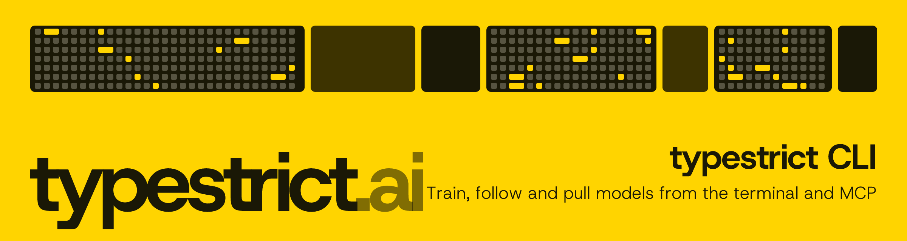

<p align="center">
  
</p>

<h1 align="center">typestrict CLI</h1>

<p align="center">
  <b>Train a decision model on your data that beats Jev, or the credit comes back.</b><br>
  From the terminal, from scripts, and from AI assistants through MCP.
</p>

<p align="center">
  <a href="https://docs.typestrict.ai/en/cli"></a>
  <a href="https://github.com/typestrict-lab/cli/releases/latest"></a>
  <a href="https://docs.typestrict.ai/en/agents"></a>
  
  <a href="LICENSE"></a>
  <a href="https://typestrict.ai"></a>
</p>

---

```bash
curl -fsSL https://typestrict.ai/install.sh | sh
typestrict login                     # paste an API key from https://typestrict.ai/settings#api-keys
```

On Windows, download the zip from the [latest release](https://github.com/typestrict-lab/cli/releases/latest).
The key can also come from `TYPESTRICT_API_KEY`.

## The flow

```bash
typestrict train tickets.csv --goal "Which team handles the ticket?" --watch   # upload, mask, read
typestrict structure <dataset>                     # the agent turns the data into training examples
typestrict review <dataset>                        # its proposal; adjust with: structure <dataset> --feedback "..."
typestrict label <dataset>                         # when asked, answer the held-out examples
typestrict run <dataset> --watch                   # shows the cost and asks before spending the credit
typestrict result <model>                          # the verdict against Jev
typestrict pull <model>                            # decision_ai.json, tokenizer.json, onnx/model_8bit.onnx
typestrict pull <model> --container                # the container image, loaded into Docker: POST /v1/systemone like Jev
typestrict pull <model> --container --platform linux/amd64   # the image for another machine (x86 servers)
```

`typestrict status` lists every training with its step and what it needs next; `status <id> --watch` follows one and
exits with 1 if it failed. `suggest`, `encoders` and `credits` do what they say. Every command takes `--json`.

## For AI assistants

The same flow as MCP tools, two ways:

- **Remote:** `https://api.typestrict.ai/mcp`, with OAuth (sign in to typestrict once) or an API key. Nothing to
  install: ChatGPT, Claude, Claude Code, Codex, Cursor, GitHub Copilot, Antigravity, Devin Desktop and others.
- **Local:** `typestrict mcp`, over stdio with your API key, when the assistant should read and save files on your
  machine.

Starting a training always takes a quote first and the user's confirmation.

```bash
claude mcp add --transport http typestrict https://api.typestrict.ai/mcp   # remote
claude mcp add typestrict -- typestrict mcp                                # local
```

This crate is also a library: the typestrict API serves these same tools remotely (`typestrict::mcp::Server::remote`).

The setup for every assistant: https://docs.typestrict.ai/agents. Skills: https://github.com/typestrict-lab/skills.

## Docs

https://docs.typestrict.ai/cli

## License

Apache-2.0.
